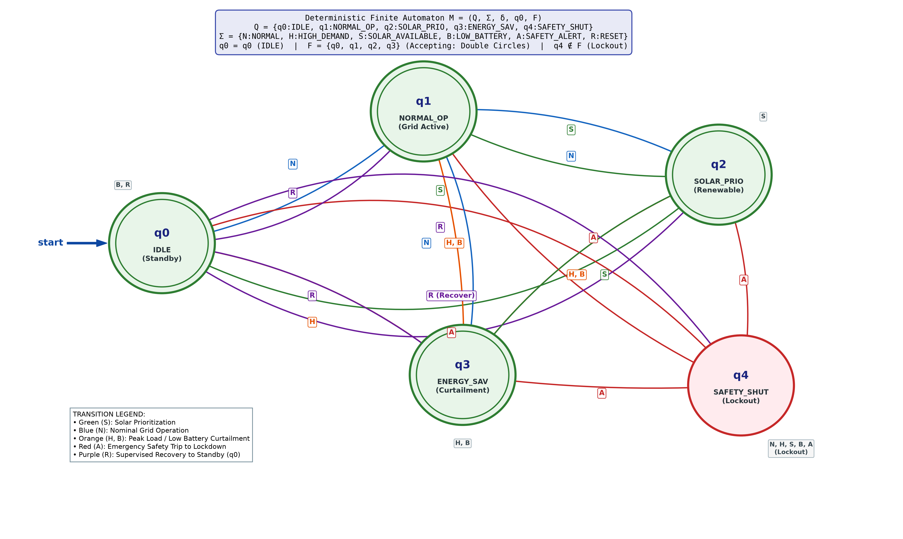

# Design and Implementation of a Deterministic Finite Automaton (DFA) for Smart-Home Energy Automation Controllers

[](https://www.python.org/downloads/)
[](docs/dfa_definition.md)
[](tests/)
[](LICENSE)

An academically rigorous, fully runnable, and mathematically validated Deterministic Finite Automaton (DFA) model for residential smart-home energy automation controllers, developed for the undergraduate course **Formal Languages and Automata Theory (FLA)**.

---

## 1. Project Overview

In cyber-physical smart-home energy management, controllers coordinate multi-source power distribution among the utility grid, rooftop photovoltaic (PV) generation, stationary battery storage, and dynamic residential loads. Relying on ad-hoc conditional scripting (`if-else` cascades) in physical electrical infrastructure leads to race conditions, unhandled edge cases, and safety lockout bypasses.

This project formalizes the supervisory energy-switching logic as a **Deterministic Finite Automaton (DFA)**:

$$M = (Q, \Sigma, \delta, q_0, F)$$

Every state-symbol pair is defined across an explicit $5 \times 6 = 30$ transition table. The controller models operational state dynamics from quiescent standby through grid delivery, solar prioritization, and load shedding, enforcing fail-safe lockout latching upon any electrical fault.

---

## 2. Formal Mathematical Definition

The automaton is formally defined by the 5-tuple $M = (Q, \Sigma, \delta, q_0, F)$:

### 2.1 Finite State Set ($Q$)
$$Q = \{ q_0, q_1, q_2, q_3, q_4 \}$$
- **$q_0$ (`IDLE`):** Quiescent standby state upon power-on. Power contactors are open; system monitors sensor telemetry before dispatching energy.
- **$q_1$ (`NORMAL_OPERATION`):** Standard grid-tied energy delivery under nominal household consumption.
- **$q_2$ (`SOLAR_PRIORITY`):** Green eco-dispatch mode prioritizing rooftop solar generation for appliances and storage charging.
- **$q_3$ (`ENERGY_SAVING`):** Demand response / peak shaving / load curtailment mode triggered by high demand ($>4.5\text{ kW}$) or low battery ($<25\%$).
- **$q_4$ (`SAFETY_SHUTDOWN`):** Emergency isolation lockout latch triggered by any electrical or thermal hazard.

### 2.2 Finite Input Alphabet ($\Sigma$)
$$\Sigma = \{ \text{NORMAL}, \text{HIGH\_DEMAND}, \text{SOLAR\_AVAILABLE}, \text{LOW\_BATTERY}, \text{SAFETY\_ALERT}, \text{RESET} \}$$
Isomorphic single-character shorthand tokens for string processing:
$$\Sigma_{\text{token}} = \{ N, H, S, B, A, R \}$$

### 2.3 Initial State ($q_0$)
$$q_0 = \text{IDLE}$$

### 2.4 Set of Accepting States ($F$)
$$F = \{ q_0, q_1, q_2, q_3 \} = Q \setminus \{ q_4 \}$$
- **Acceptance Meaning ($w \in L(M)$):** The sequence leaves the controller in a healthy, compliant operating state.
- **Rejection Meaning ($w \notin L(M)$):** The sequence drives the controller into an unrecovered emergency lockdown ($q_4$).
- **Empty Word ($\epsilon$):** $\delta^*(q_0, \epsilon) = q_0 \in F$ (accepted safe baseline prior to disturbance).
- *Academic Notice:* Acceptance by this mathematical DFA confirms language membership under the formal model; it does not constitute physical electrical certification of physical wiring.

---

## 3. Complete State Transition Table ($\delta: Q \times \Sigma \to Q$)

The transition function is total and deterministic ($|Q| \times |\Sigma| = 5 \times 6 = 30$ entries):

| Current State ($q \in Q$) | $N$ (`NORMAL`) | $H$ (`HIGH_DEMAND`) | $S$ (`SOLAR_AVAILABLE`) | $B$ (`LOW_BATTERY`) | $A$ (`SAFETY_ALERT`) | $R$ (`RESET`) |
| :--- | :---: | :---: | :---: | :---: | :---: | :---: |
| **$\to q_0$ (`IDLE`)** | $q_1$ | $q_3$ | $q_2$ | $q_0$ | $q_4$ | $q_0$ |
| **$* q_1$ (`NORMAL_OPERATION`)** | $q_1$ | $q_3$ | $q_2$ | $q_3$ | $q_4$ | $q_0$ |
| **$* q_2$ (`SOLAR_PRIORITY`)** | $q_1$ | $q_3$ | $q_2$ | $q_3$ | $q_4$ | $q_0$ |
| **$* q_3$ (`ENERGY_SAVING`)** | $q_1$ | $q_3$ | $q_2$ | $q_3$ | $q_4$ | $q_0$ |
| **$q_4$ (`SAFETY_SHUTDOWN`)** | $q_4$ | $q_4$ | $q_4$ | $q_4$ | $q_4$ | $q_0$ |

*Notation:* $\to$ indicates initial state ($q_0$); $*$ indicates accepting states ($q \in F$).

### Key Safety Invariants
1. **Emergency Trip:** $\forall q \in Q, \; \delta(q, A) = q_4$.
2. **Lockdown Latching:** $\forall \sigma \in \{N, H, S, B, A\}, \; \delta(q_4, \sigma) = q_4$.
3. **Controlled Recovery:** $\delta(q_4, R) = q_0$ (strictly returns to un-energized standby, never directly to load).

---

## 4. State Transition Diagram



*(Generated automatically with double-circle accepting states, single-circle fault latch, and token groups via `src/visualize_dfa.py`).*

---

## 5. Repository Structure

```text
dfa_smart_home_energy/
│
├── src/
│   ├── dfa_controller.py      # Core DFA 5-tuple engine, transition table, and sensor discretizer
│   ├── simulator.py           # Interactive CLI harness and telemetry runner
│   └── visualize_dfa.py       # High-res Matplotlib diagram & Graphviz DOT generator
│
├── tests/
│   ├── test_dfa_controller.py # 26 automated unit tests (determinism, safety, completeness)
│   └── test_scenarios.py      # Automated validator for JSON scenarios
│
├── data/
│   └── sample_scenarios.json  # 10 formal demonstration scenarios with traces & justifications
│
├── docs/
│   ├── dfa_definition.md      # Formal mathematical specification and safety theorems
│   ├── state_diagram.png      # 300-DPI publication-grade state diagram
│   └── state_diagram.dot      # Standard Graphviz source specification
│
├── report/
│   ├── project_report.md      # Full 22-section academic project report
│   ├── export_pdf.py          # ReportLab PDF compiler matching institutional format
│   └── project_report.pdf     # Compiled publication-grade PDF report (8 pages)
│
├── requirements.txt           # Minimal optional dependencies (matplotlib, pillow, reportlab)
├── .gitignore                 # Standard Python exclusions
└── README.md                  # Project documentation and user guide
```

---

## 6. Installation & Prerequisites

### Prerequisites
- Python 3.10 or higher.
- Core automaton engine and tests require **only the Python standard library**.
- Optional plotting and PDF generation require `matplotlib`, `pillow`, and `reportlab`.

### Setup
```bash
# Clone or navigate to the project directory
cd dfa_smart_home_energy

# (Optional) Create and activate virtual environment
python -m venv .venv
# On Windows:
.venv\Scripts\activate
# On Linux / macOS:
source .venv/bin/activate

# Install optional visualization dependencies
pip install -r requirements.txt
```

---

## 7. Execution Guide

### 7.1 Running the Interactive Simulator
Launch the interactive CLI harness:
```bash
python src/simulator.py
```
**Menu Features:**
1. View formal transition table $\delta(Q, \Sigma)$.
2. Run academic demonstration scenarios (10 scenarios).
3. Interactive step-by-step event injection (type `N`, `H`, `S`, `B`, `A`, `R`).
4. Process batch custom strings (e.g., `N, S, H, B, A, R`).
5. Continuous sensor telemetry discretization simulation.

### 7.2 Running Automated Unit Tests
Execute the full test suite with verbose output:
```bash
python -m unittest discover -s tests -v
```
*Expected Result:*
```text
Ran 27 tests in 0.020s
OK
```

### 7.3 Regenerating the State Diagram
Regenerate both `docs/state_diagram.png` and `docs/state_diagram.dot`:
```bash
python src/visualize_dfa.py
```

### 7.4 Compiling the Academic PDF Report
Rebuild the 8-page academic PDF report matching the institutional template:
```bash
python report/export_pdf.py
```

---

## 8. Sample Execution Traces

### Example: Supervised Reset Recovery (Scenario 6)
```text
Evaluating Input Sequence: 'N, A, R, N'
------------------------------------------------------------------------------
  Step 01: δ(IDLE (q0), NORMAL ('N')) --> NORMAL_OPERATION (q1)  [ACCEPTING]
  Step 02: δ(NORMAL_OPERATION (q1), SAFETY_ALERT ('A')) --> SAFETY_SHUTDOWN (q4)  [NON-ACCEPTING]
  Step 03: δ(SAFETY_SHUTDOWN (q4), RESET ('R')) --> IDLE (q0)  [ACCEPTING]
  Step 04: δ(IDLE (q0), NORMAL ('N')) --> NORMAL_OPERATION (q1)  [ACCEPTING]
------------------------------------------------------------------------------
State Sequence Trace: q0 -> q1 -> q4 -> q0 -> q1
Initial State       : IDLE (q0)
Final State         : NORMAL_OPERATION (q1)
Evaluation Outcome  : ACCEPTED (w ∈ L(M))
Summary             : ACCEPTED: System reached compliant operating state 'NORMAL_OPERATION' (q1 ∈ F).
```

---

## 9. Computational Complexity & Theoretical Guarantees

- **Time Complexity:**
  - Per Transition: $\mathcal{O}(1)$ constant time via direct hash table lookup.
  - Per Sequence of Length $n$: $\mathcal{O}(n)$ linear time.
- **Space Complexity:**
  - Transition Table: $\mathcal{O}(|Q| \times |\Sigma|) = \mathcal{O}(30) = \mathcal{O}(1)$ auxiliary memory.
  - Runtime State: $\mathcal{O}(1)$ single state variable.
- **Embedded Portability:**
  - Can be flashed directly to resource-constrained microcontrollers (e.g., ATmega328P with 2 KB RAM, ESP32) without dynamic heap allocation.

---

## 10. Git Commands for Repository Publishing

To initialize a local Git repository and push this project to GitHub:

```bash
# 1. Initialize local git repository
git init

# 2. Stage all project files
git add .

# 3. Create initial commit
git commit -m "feat: complete academic implementation of DFA smart-home energy controller"

# 4. Set default branch to main
git branch -M main

# 5. Link your GitHub remote repository (replace with your actual GitHub repo URL)
git remote add origin https://github.com/<YOUR_USERNAME>/dfa-smart-home-energy.git

# 6. Push code to GitHub
git push -u origin main
```

---

## 11. Limitations & Future Scope

### Limitations
- The DFA operates in discrete logical steps over discretized event tokens.
- It models supervisory discrete-event logic and does not measure live analog electrical waveforms or trigger physical circuit breakers directly.

### Future Scope
1. **Mealy/Moore Machine Transducer:** Emit discrete actuator commands (`TRIP_BREAKER`, `ACTIVATE_INVERTER`) along transition edges.
2. **Pushdown Automata (PDA):** Incorporate stack memory to track cumulative daily energy consumption quotas.
3. **Firmware Port:** Cross-compile the transition table to C/C++ firmware for ESP32/STM32 platforms.

---

## 12. Academic Citation & References

```bibtex
@article{ramadge1989control,
  title={The control of discrete event systems},
  author={Ramadge, Peter J and Wonham, W Murray},
  journal={Proceedings of the IEEE},
  volume={77},
  number={1},
  pages={81--98},
  year={1989}
}
@book{hopcroft2006automata,
  title={Introduction to Automata Theory, Languages, and Computation},
  author={Hopcroft, John E and Motwani, Rajeev and Ullman, Jeffrey D},
  year={2006},
  publisher={Addison-Wesley}
}
```
